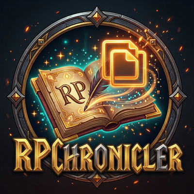
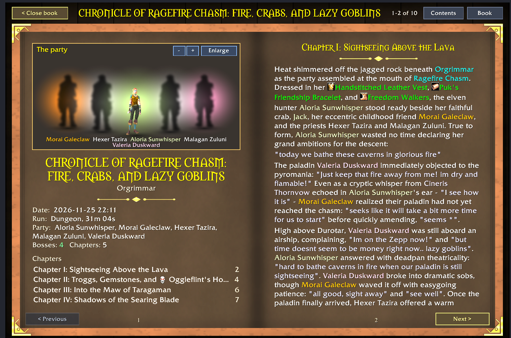
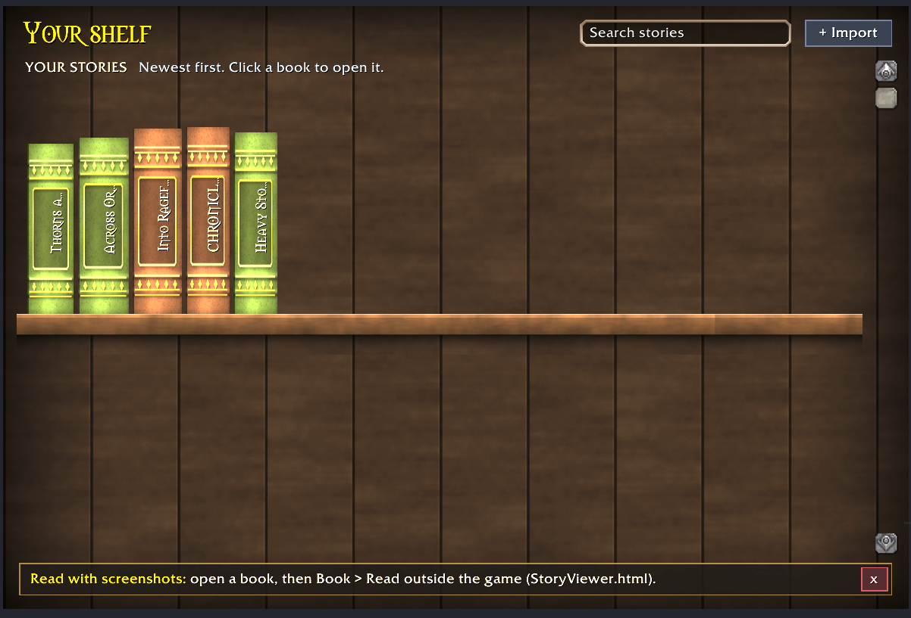
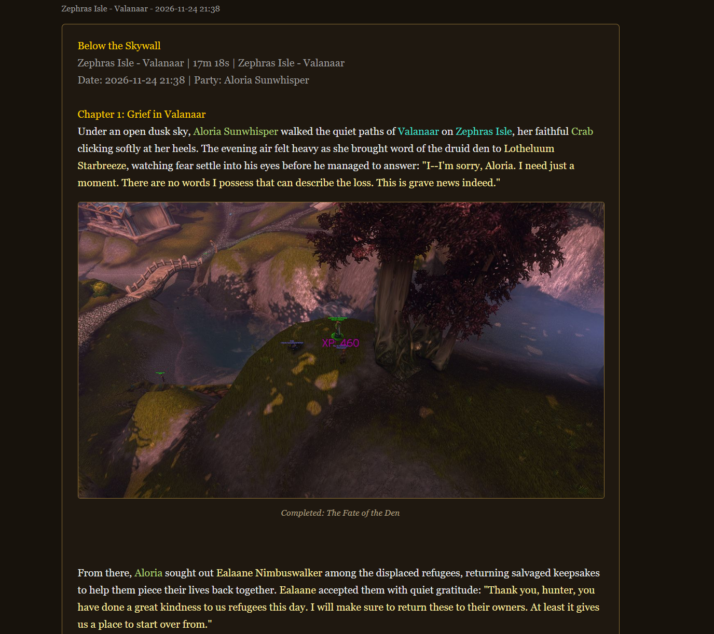
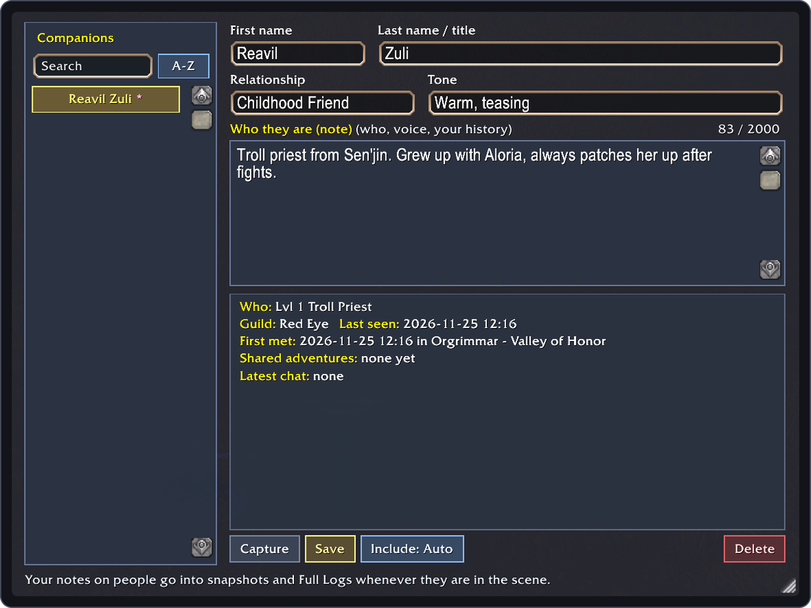

<p align="center"></p>

<h1 align="center">RP Chronicler</h1>

<p align="center"><b>Record your World of Warcraft: Forever adventures and read them back as stories. Great for chronicling your runs with friends. Plus one-key RP replies for your own character.</b></p>

<p align="center"><a href="https://www.curseforge.com/wow/addons/rpchronicler"><b>Download RP Chronicler on CurseForge</b></a></p>

RP Chronicler is a free addon that sits between WoW and the AI you already use (Gemini, ChatGPT or Claude). It never sends chat and never goes online. It copies text out, and you decide what to paste back. The only thing it ever sends is its version number to your group and guild, so you hear when there is an update (you can turn that off).

**Made for roleplay adventures.** RP Chronicler is mostly for players who roleplay through their runs. What happens in character shapes the story: what you and your party say in the dungeon, the emotes, your character's thoughts (Story Notes), who saved whom. Play it in character, and the story you get back is your roleplay, not just a list of kills.

**What it does:**

- **Runs become stories.** Entering a dungeon asks whether to record it, and open-world adventures record when you start them. Raids: coming soon. RP Chronicler packs fights, bosses, quests, places, levels, loot and party banter into one Full Log. Your AI turns it into a colored story that you read in the in-game **Story Book**.
- **Your character's inner voice.** Add a **Story Note** (a thought, a fear, a memory) while you record, with `/rp note` or a key, and the story weaves it in. **Edit run** fixes the run before you make the story, even while it records: pick the dungeon, set a member's role, or correct a name the game got wrong.
- **Stories with your screenshots.** Your screenshots join the run with captions. `StoryViewer.html`, in the addon folder, shows every story in your browser with the pictures placed in the story, and saves it as one web page you can keep or share. A timeline with **Play** walks you through the run's big moments.
- **One-key RP replies.** Press `Ctrl+C` and RP Chronicler copies the scene: who spoke to you, your target, your party, your pet, your quest, recent chat and your notes on the people there. Paste it into your AI with your character skill and get five short in-character lines, one per mood. Paste your favorite into chat.
- **Companions that remember.** Save players, NPCs and pets with their relationship, tone and one note on who they are and what you went through together. Your notes go into every copy where that person is in the scene.
- **Use what you want.** RP Copy and the recordings are separate: the setup on first login asks whether you want RP Copy, recordings and stories, or both. Turn RP Copy off and none of it runs.
- **Private by design.** Everything stays on your PC, and `/rp wipe` deletes it all.

<p align="center"><br><i>A story open in the Story Book</i><br><sub>Your party on the title page. Members you have not met up close stay shadows until you meet them again.</sub></p>

<p align="center"><br><i>Your stories on the shelf</i></p>

<p align="center"><br><i>A story as a web page, screenshots in place</i></p>

**How an RP reply works:**

1. **In WoW**, someone talks to you. Press `Ctrl+C` and RP Chronicler copies the scene.
2. **In your own AI** (Gemini, ChatGPT or Claude, with your character skill), paste it. Its first line, `[Skill Call] use <trigger>`, calls your skill. By default the trigger is your character's first name (`use aloria` for Aloria), so name your skill's trigger the same, or change the Skill Call in **Options > Slice Tabs**.
3. **Your AI answers** with five short in-character replies, one per mood. Pick the one you like there and copy it.
4. **Back in WoW**, paste it into chat (`/s`, `/p`, `/w` and so on) and send it yourself.

- **Version:** 0.7.0 beta (interface `16001`, WoW: Forever)
- **Saved variables:** `RPChroniclerDB` (account-wide, on your PC only)
- **License:** GPL-3.0

**Contents:** [Quick start](#quick-start) | [Requirements](#requirements) | [Character skill](#the-character-skill) | [Companions](#companions) | [Slice tabs](#slice-tabs) | [Adventures](#adventures-recording-runs) | [Library](#the-library) | [Sharing](#sharing-a-story) | [Screenshots and export](#screenshots-and-export) | [Privacy](#privacy) | [Commands](#slash-commands) | [Keybinds](#keybindings) | [Bugs](#reporting-bugs) | [Install](#installation) | [Developers](#for-developers)

---

## Why RP Chronicler

- **RP without the typing.** In a busy party or a fast whisper exchange you don't have time to write a good reply. One key gives your AI the whole scene.
- **Your character, consistently.** The skill holds your character's voice, moods, faction and running jokes, so every reply sounds like the same person.
- **Context the AI can't see.** Where you are, who you're talking to and what they said, combat, HP, your pet, your party, your quest, and your own notes on the people around you.
- **You stay in control.** RP Chronicler only copies text out. You choose what to say and paste it yourself.

---

## Quick start

1. **Install** the addon (see [Installation](#installation)) and log in. A short **setup** opens once: what you want to use (RP Copy, recordings and stories, or both), whether dungeons ask to record, and screenshots. Click **Start**, and change any of it later in **Options**.
2. Type `/rp`. The window is a leather tome. Its ribbons on the left open the **Library** (your stories), the **Journal** (your recordings), **Players** (companions), **Copy** (hidden while RP Copy is off) and **Options** (the Binder's Desk, the key ribbon). The plaque at the top starts and ends a recording.
3. **Create your character skill** (one time): gear > **AI & Stories** > **RP Template**, copy it, paste it into your AI, fill in your character, and pick a short trigger such as `use <your name>`. Enter that trigger as the **Skill Call** in **Options > Slice Tabs**. See [The character skill](#the-character-skill).
4. **Play.** When someone talks to you, press `Ctrl+C` (or `/rp quick`). A toast confirms the copy. To steer the AI, use `/rp <instruction>`, for example `/rp make it flirty`.
5. **Paste into your AI.** It replies with 5 short options written for the channel. Copy one into WoW chat.

<details>
<summary><b>What a snapshot looks like</b></summary>

```
[Skill Call] use aloria
[Location] The Barrens - Crossroads
[Direct] [Whisper] Thrallgar: you look lost, need a hand with those raptors?
[Target] Thrallgar - Lvl 14 Orc Warrior [Friendly] [100%]
[Party] Aloria (Hunter) [DPS], Thrallgar (Warrior) [Tank]
[Status] Lvl 14 Hunter | 82% HP | [Out of Combat] | Pet: Snips (Crab) [Content]
[Known Player: Thrallgar]
Relationship: friendly rival, teasing
Who they are: loud orc warrior, owes me 5 silver. We cleared Wailing Caverns together and he pulled every patrol.
```

The `[Known Player]` block is added because Thrallgar is a saved companion with your notes (see [Companions](#companions)).

</details>

<details>
<summary><b>Example: from snapshot to replies</b></summary>

You press `Ctrl+C` in party chat and paste this into your AI:

```
[Skill Call] use aloria
[Location] Elwynn Forest - Northshire Valley
[Party] Thorgar: who just pulled the entire patrol
[Status] Lvl 6 Hunter | 64% HP | [In Combat] | Pet: Snips (Crab)
```

The skill answers with five options, one per mood, ready to paste into `/p`:

```
1. deadpan dramatic: destiny demanded a true test of our strength
2. petty & sharp:    my aim slipped, partly your fault for standing there
3. broke & wholesome: bright side, more pockets to loot if we live
4. pet-brained:      my pet made an executive decision
5. chaotic overkill: i'm vanishing in three seconds, good luck everyone
```

</details>

---

## Requirements

RP Chronicler is free and runs inside the game. You also need an AI chat that can keep a reusable set of instructions (a "skill"). Each of these has one on its free plan:

| AI | Where the skill lives |
|---|---|
| **Google Gemini** | A **Skill**: create a new Skill and paste the template as its instructions |
| **ChatGPT** | A **Project**: New project, paste the template into its instructions |
| **Claude** | A **Project** (paste the template into its instructions) or a **Skill** |

If your AI or plan has none of these, paste the template at the start of a new chat each time. It works, it's just more steps.

**Which model?** Fast, light models are fine for short RP replies. For stories, use the strongest model your AI offers (its "pro" or "thinking" model): it follows the color rules better and keeps the whole run in mind. If a story comes out short or forgets the start of the run, switch to a stronger model, or pick a shorter **Log detail** in **Options > Recording**. The **size line** above each Full Log shows how long the copy is: 80k characters fits most free AI chats, and paid ones can fit a lot more words. It turns orange near 80k and red past it.

**Stories need no skill.** The Full Log box shows the log alone. Tick **Include AI instructions** above it and the story rules go in front, so any AI chat on any plan writes the story from one paste. The rules come from your installed RP Chronicler, so they always match it. No AI at all? **Import Story > Quick Chronicle** (a test feature) writes a short one in game (see [Adventures](#adventures-recording-runs)).

**Building a skill (one time each, optional for stories):**

1. In RP Chronicler, open gear > **AI & Stories** and copy a template: **RP Template** for your character, **Dungeon Story** and **Adventure Story** for the storyteller (then copy Full Logs with **Include AI instructions** off, so they stay short).
2. In your AI, make a Skill (Gemini or Claude) or a Project (ChatGPT or Claude), and paste the template as its instructions. For the RP template, fill in your character first.
3. Open a chat with that skill and paste what RP Chronicler copied. The first line (`use <trigger>`, `use wow-dungeon-raid-story`, `use wow-open-world-story`) tells the AI which skill to use. The story lines are the skills' own names from the templates.

---

## The character skill

The RP template is a **starter**. Personalize it: replace every `<...>` field and make it yours, with your character's personality, backstory, voice, quirks, five moods and the way they talk. The more of your character is in it, the better the replies.

The template asks the AI for:

- **A voice that reacts to the room.** Replies engage with the actual joke, quest, monster or player in the log, and never recycle stock catchphrases.
- **Chat-sized lines.** Casual lowercase, one short sentence each. Pick **Short**, **Medium** or **Long** replies in **Options > AI & Stories** before you copy the template.
- **Five moods.** You name them (for example deadpan dramatic, petty, wholesome, pet-brained, chaotic overkill), and each option is labeled with its mood.
- **Channel rules.** General and Guild stay conversational, Party is teammate banter, Say may use an emote, Whisper is one-on-one. No `/s` or `/p` prefixes.
- **Your notes.** `[Known Player]` blocks shape how your character talks to someone, without quoting your notes. An `[Instruction]` line is your direction, never chat.

You can keep several characters. Give each one its own skill and trigger, and switch the Skill Call in Options or make a separate slice tab per character.

<details>
<summary><b>Show the RP skill template</b></summary>

```text
---
name: <character-name>-rp-<class>
description: Generate short, lively World of Warcraft: Forever roleplay responses for a <gender> <Faction> <Race> <Class> (<Character Full Name>) inspired by <Persona Inspiration>. Use when the user pastes an RP Chronicler snapshot or a WoW chat screenshot for <First Name>, mentions <trigger> or <surname> (such as "use <trigger>"), or asks for <Class> RP replies in General, Guild, Say, Party or Whisper chat.
---

STARTER TEMPLATE: personalize it. Replace every <...> field, and make it yours: personality, backstory, voice, quirks, the 5 moods and how your character talks. The more of your character is in here, the better the replies. Delete this paragraph when you are done.

WOW FOREVER RP: <FACTION> <RACE> <CLASS> (<CHARACTER FULL NAME>)

Generate 5 short, natural, in-character English chat replies for <Character Full Name>, a <three or four personality words> <Faction> <Race> <Class> in World of Warcraft: Forever, inspired by <Persona Inspiration>.

WHEN TO USE

- The user pastes an RP Chronicler snapshot that starts with "[Skill Call] use <trigger>" (with [Location], [Target], [Status], chat lines and maybe [Known Player] blocks), or uploads a WoW chat screenshot for <First Name>.
- The user includes triggers like "use <trigger>", "<trigger>" or "<surname>".
- The user asks for quick in-character <Class> responses in any WoW chat channel.

VOICE AND PERSONALITY

<First Name> feels alive because <she/he/they> actually reacts to what people are saying in chat instead of reciting catchphrases. <Describe the core of the voice in one or two sentences: the kind of humor, the attitude, what flips their mood.>

- React to the room first: engage directly with the specific joke, quest, monster or player in the log. Never force <Class> buzzwords into every line if they do not fit the conversation.
- Never repeat stock catchphrases: no canned openers like "i am <name>, the great...", and never reuse the same pet, spell or gear joke across turns. Invent fresh angles every time.
- Casual WoW chat rhythm: natural lowercase without stiff punctuation. Keep every option punchy: one short sentence or chat fragment (most about 5 to 14 words), never two sentences and never long comma-spliced speeches.
- Vary the length across the 5 options: some are a few words, one may run a little longer when the moment calls for it.
- [Known Player] blocks are the user's own notes on the people in the scene (relationship and who they are to <First Name>). Let them shape how <First Name> talks to that person, but never quote a note.
- If the snapshot has an [Instruction] line, it is the user's direction for these replies (tone, focus, who to answer). Follow it. It is not chat and never something a character said.

THE 5 RESPONSE ANGLES

Give 5 distinct options, one per mood, labeled with the mood:

1. <mood 1 name>: <one line on what this mood does, e.g. delivers an overly grand verdict on an ordinary situation, completely straight-faced>
2. <mood 2 name>: <e.g. quick snark, competitive pride, or a ridiculous excuse to save face>
3. <mood 3 name>: <e.g. counts every copper, eyes free food or loot, or shows a soft spot for allies>
4. <mood 4 name>: <a class or companion angle, e.g. blames the pet, a spell gone wrong, or questionable engineering>
5. <mood 5 name>: <e.g. casually escalates a minor problem into maximum collateral damage, then plans a quick exit>

CHANNEL AND FORMATTING RULES

- No channel prefixes: never start lines with /1, /g, /p, /s or /w. Output pure copy-paste-ready text.
- Match the channel:
  - [General] / [Guild]: zone or guild chatter. Keep it conversational and skip physical actions that distant players cannot see.
  - [Party]: teammate banter aware of pulls, mana breaks, loot and group survival.
  - [Say]: face to face. A standalone WoW emote (/shrug, /sigh, /giggle, /ponder) may go on its own line when it fits.
  - [Whisper]: a direct one-on-one reply tailored to the sender.
- Clean text: keep at least 4 options free of *action* asterisks (at most 1 brief *action*, only if it sharpens the joke). Always write in English.

EXAMPLES (replace them with lines in your character's own voice)

Input: [1. General] [Kaelen]: anyone seen the rare tiger spawn near the ridge?

1. <mood 1>: that beast and i have unfinished business, stay back
2. <mood 2>: even if i did, why would i hand over my own prey?
3. <mood 3>: if it drops decent leather, i'm helping you look
4. <mood 4>: you mean my future best friend? don't you dare
5. <mood 5>: just pull the whole ridge and i'll sort out the survivors

Input: [Party] [Thorgar]: who just pulled the entire patrol

1. <mood 1>: destiny demanded a true test of our strength
2. <mood 2>: my aim slipped, partly your fault for standing there
3. <mood 3>: bright side, more pockets to loot if we live
4. <mood 4>: my pet made an executive decision
5. <mood 5>: i'm vanishing in three seconds, good luck everyone
```

The reply-length line changes with the **Short / Medium / Long** setting in **Options > AI & Stories**. The RP template is part of RP Copy, so it is hidden while RP Copy is off.

</details>

---

## Companions

<p align="center"></p>

The more your AI knows about who you're talking to, the better the replies get. A companion can be a player, an NPC or a pet.

- **Add someone:** target them and click **Capture Target** in Companions, type `/rp capture`, use the **Capture Target** key you set in the game's Key Bindings, or right-click a player in game and pick **Add as RP Chronicler companion**.
- **Write your notes:** first and last name, **Relationship** and **Tone**, plus one note, **Who they are (note)**, for who they are and what you went through together (up to 2000 letters, with a counter). In 0.6.1 the old **Our history** note was added to the end of **Who they are**, so nothing was lost. Auto-updates never touch your notes.
- **Find them again:** search the list and sort by name, last seen or first met. Each companion shows their class, guild, when you last saw them, when you first met, the runs you shared, and their latest chat.
- **Include:** per companion, **Auto** adds them when they are your target, in your group, nearby (on screen or chatting in the last 5 minutes) or in the copied chat, **Always** adds them to every copy, and **Never** keeps them out.
- **Nearby companions:** a chip at the bottom of the Copy view shows the saved companions around you: targeted, in your group, on a nameplate or mouseover, or chatting in the last 5 minutes. Someone you just added counts as nearby at once. Click it to open the first one.
- **In your runs:** companions you chat with during a run are listed in its Full Log with your notes, so the storyteller knows who they are.

Options > **Companions** turns each of these on or off. A copy holds up to 3 companion blocks, with notes cut to 300 letters.

---

## Slice tabs

Each tab is a "slice": a preset of what goes into the snapshot.

<details>
<summary><b>The built-in slices and how the copy reads</b></summary>

| Tab | Best for |
|---|---|
| **Chat** | Conversations nearby: the message to you, your target, say, yell, emotes and whispers |
| **World** | General, Trade, LFG and other numbered channels (never the OOC channel) |
| **Party** | Your group: party and raid chat, say and emotes from members, and the roster (since 0.6.5 no target or status lines; add them back in Slice Tabs) |
| **Guild** | Guild chat and officer chat |
| **Quest** | Questing flavor: your active quest, your target and NPC dialogue |
| **Loot** | Reacting to drops: green and better items and your coin, summed |

Change what every tab copies, built-in ones included, in **Options > Slice Tabs**, and add **custom tabs** with their own Skill Call. `Ctrl+C` always copies the slice you used last.

- **One timeline.** All the chat a tab includes is merged into one list in the order it happened.
- **No repeats.** The message to you is marked `[Direct]` in the timeline instead of being copied twice, and a companion's "Latest Chat" leaves out lines the copy already shows.
- **Busy channels stay out of the way.** Trade, General and LFG have their own buffer, and guild chat another, so they never push nearby RP out.
- **Clean loot.** Green and better items and who won them are kept, gray items and roll messages are left out, and coin is summed into one line.
- **One-time instructions.** `/rp make it flirty` or `/rp reply to Thrall only` goes at the top as `[Instruction]`, so the AI follows it instead of treating it as chat.

</details>

---

## Adventures: recording runs

RP Chronicler also works as a quiet chronicler. A recording captures what a storyteller needs: who was there, where you went, what you fought, who nearly died, what dropped, the quests you did, and what everyone said. It packs that into one **Full Log** that's ready to paste into your AI.

1. **Play.** Entering a dungeon asks **Start recording this run?** (**Options > Recording > Dungeons**: **Ask on entry**, **Always record** or **Never**), and the run ends when you leave. Raids are coming soon (TBA): RP Chronicler supports dungeons and the open world for now, so entering a raid asks nothing. In the open world, click **Start Recording**, use the RP button's right-click menu or a key you set in the game's Key Bindings.
   The roster lists each member once, by full name, and only people who were really in the run with you: someone invited by mistake, or who never zoned in, is left out. Each member's role is the one they ended the run with, so a role fixed mid-run is right.
2. **Copy the Full Log** in Adventures: open **Full Log**, tick **Include AI instructions**, click **Copy for AI**, then `Ctrl+C`. The box shows the log alone until you tick it; then the story rules go in front (one chapter per boss for dungeons, chapters by place and event for the open world); the size line counts them at once.
3. **Paste it into any AI chat** and copy back the colored story it writes.
   **Advanced: use a skill.** Make the **Dungeon Story** and **Adventure Story** templates (gear > **AI & Stories**) skills in your AI. Leave **Include AI instructions** off: the copy then stays short, starting with `use wow-dungeon-raid-story` or `use wow-open-world-story`. When the story rules change in an update, RP Chronicler tells you once to copy the template again.
   **No AI?** In **Import Story**, pick the run and click **Quick Chronicle (test)**. It is a test feature, so the writing is still rough: RP Chronicler writes a short chronicle in game from the run's own log, with chapters per boss (or per place), the fights, deaths and wipes, real in-character quotes and your Story Notes. It reads like a journal, not a novel, and it says so at the top. A story from your AI replaces it later.
4. **Import Story** and paste the colored story. It opens in the [Story Book](#the-library), named after the title the AI gave it. Every recording has a **Run ID** in its Full Log header, and the AI copies it onto the story's last line, so the story links itself to the right recording. Picking a run by hand is optional, and a story with no recording at all can be imported too.

<details>
<summary><b>How recording works</b></summary>

- **One Start / Stop button**, green to start and red (**Stop & Save**) while a run records, with **Pause** and **Mark Moment** next to it. Each also has a command and a Key Bindings entry.
- **The RP button** sits on the minimap's edge (drag it around the minimap), or floats anywhere on the screen if you choose **Options > General > RP button > Floating**. Left-click opens the window. Right-click opens a menu: Start or Stop, Pause or Resume, Mark Moment, **Open current recording**, Story Book, **Feedback / bug report**, Clear chat logs. Both show the RP Chronicler logo. While recording, the floating button glows red (the minimap button shows a pulsing red dot); while paused, its logo dims and shows a pause badge (amber dot on the minimap).
- **Never lost.** After a `/reload` or a short disconnect the run continues. After a logout or a longer disconnect it is saved as **interrupted**, and the next login asks whether to **resume** or **keep** it.
- **Rich but short.** One meaningful line instead of many raw ones, and never out-of-character chat: `(( ))`, `[OOC]`, the OOC channel, guild and world channels stay out.
- **A Summary by run type.** Zeros are hidden, bosses and wipes show only for dungeons, places only for the open world.
- **Roles always shown.** When nobody picked a role, RP Chronicler guesses Tank, Healer or DPS.
- **Fight context on chat**, for example `[Party | vs Boss 5% HP] Healer: OOM!!`.
- **Story Notes.** While a run records, **Note** on the record bar, `/rp note <text>` or the **Add a Story Note** key adds your character's thought as a `[NOTE]` line. The AI treats it as inner voice, never as spoken dialogue.
- **Edit run** (under the run, also while it records):
  - **Dungeon:** **Change** picks it from Forever's dungeons (levels 1 to 60). The run's name follows, and the story finds the right boss models. **Undo** brings the recorded one back.
  - **Roles:** each member gets the roles their class can take (a Warrior Tank or Damage, a Paladin or Druid any of the three, a Priest or Shaman Healer or Damage; Hunters, Rogues, Mages and Warlocks are always Damage). Your pick wins over what the game reports later; **Undo** takes it back.
  - **Names:** click a name, type the right spelling and **Replace**: the Full Log, the Summary and the story details use the fix, and **Undo** takes it back.
- **Sorted runs.** Tabs above the list show **All**, **World** (open world) or **Dgn** (dungeons). **Raid** is greyed until raids arrive.
- **What you wore.** The Full Log names the green or better gear you wore when the run began, so the story can describe it.
- **Who they are.** The roster gives each member's sex and race (for example `female Tauren Druid`), so the story gets pronouns and looks right. Runs recorded before 0.6.4 fill these in the next time you see that player.
- **Story length.** Long open-world runs ask for fewer, fuller chapters (3 to 6, by length), with related quests grouped into one stretch.
- Up to 40 runs are kept. When a new run pushes out the oldest one, and that one has no story yet, chat tells you.

</details>

<details>
<summary><b>The Full Log tags</b></summary>

Every line is timestamped `[HH:MM:SS]`. **Options > Recording** has a switch for each group of lines (fights and kills, bosses and danger, quests and NPCs, travel and progress, loot, group chat) and a **Log detail** of Short, Normal or Rich.

- `[FIGHTS]` a streak of plain trash fights folded into one line that updates as you go, for example `[FIGHTS] 6x Defias Thug (14:02-14:09) - all defeated - 1 fled briefly - used Multi-Shot, Serpent Sting`
- `[FIGHT]` one line for a notable fight, with the spells used, who took aggro, fleeing, and how it ended (defeated, it escaped, the party disengaged)
- `[KILL]` elites, rares and named foes. Trash is counted in the header as **Foes defeated**, broken down by type.
- `[PVP]` hostile players defeated, and PvP deaths
- `[BOSS ENGAGED]`, `[BOSS HP]` at 50%, 20% and 5%, `[BOSS RESET]`, `[BOSS KILL]`, `[BOSS CAST]`, `[WIPE #N]`
- `[AGGRO]`, `[DANGER]` under 10% HP, `[SAVED]`, `[LOW MANA]`, `[DEATH]` with what you were fighting, `[REZ]`
- `[SPELL]` only for big cooldowns and crowd control (other spells are folded into the fight line), `[CC]`, `[PET]` and `[PET DEATH]`. Pets are written as name and family, for example `Snips (Crab)` for a crab named Snips, or `Crab (Crab)` for a crab still named Crab.
- `[QUEST]` quests accepted and completed, and `Objective done: <quest> - <objective>`. `[QUEST TEXT]` is the quest giver's words, trimmed.
- `[NPC]` and `[NPC Emote]` from bosses and named NPCs, throttled and de-duplicated
- `[LEVEL]`, `[PLACE]` new subzones (once they settle, no repeats)
- `[MILESTONE]` a new spell, a tamed or renamed pet (with its species), a new mount or companion pet, an achievement, a reputation
- `[LOOT]` quest items and green or better items with their source. Repeats of the same item become one line with `xN`.
- `[SHOT ID]` a screenshot and what was happening, with an ID made of the Run ID and its number, for example `[SHOT TPX8OK-2]` (see [Screenshots](#screenshots-and-export))
- `[HIGHLIGHT]` moments you marked
- `[NOTE]` your character's thoughts (Story Notes)

The header has the run type, zone, date and duration, levels gained, quests completed and places (open world), wipes (dungeons and raids), deaths, the roster with roles, guild and pets, Known companions with your notes, bosses, foes defeated, notable kills and loot.

</details>

---

## The Library

The Library (the red ribbon, and where `/rp` opens) is your Story Book: wooden shelves where every story stands as a leather book with gold bands, its chapter emblem and its title on the spine.

- **Shelves.** **Finished tales** holds your stories, **Waiting for their story** shows your recordings that have no story yet as unbound pages (click one to open it in the Journal and give it its story), and **Gifts** holds books friends gave you. Click a shelf's name (or right-click a book) to add a shelf, rename, reorder or delete one, or move a book to another shelf. A book on a deleted shelf goes back to Finished tales.
- **Chapter emblems.** Each chapter can open with a small inked emblem (a skull for a boss, a road for travel, a cave, a ship and about 40 more). The story templates ask the AI for one `[emblem: name]` line under each chapter title; the line itself is never shown.
- **Bosses in the text.** Point at a boss's name in a story and a small window shows the boss (from the Encounter Journal, or RP Chronicler's own list; a skull when it doesn't know it).

- **The shelf.** Your stories stand newest first, each book colored by its kind of run. A story you imported this session glows until you open it. Point at a book for its date, place, kind of run, party and length; click it to open it. **Search** finds stories by title, place, party member or date, and **+ Import** adds a new story.
- **The open book.** A book taken from the shelf lies closed, front cover up: its title, where it happened, its emblem and its party. Click the cover (or **Next >**, or the mouse wheel) and it swings open across the whole window as two facing pages. The first page of a story is its title page: the party scene, the title, the place, the date and the run's numbers, with a list of its chapters (click one to go there). Every chapter starts on a new page. Turn pages with **< Previous** and **Next >** under the pages, or the mouse wheel; **Contents** goes back to the start. On the first pages **< Front cover** closes the book again, and after the last page **Back cover >** shows its back cover, with a few lines from the story, the party and the run. **< Close book** closes it and puts it back on the shelf. In a narrow window the book shows one page at a time.
- **The Book menu** (top right of the open book) holds everything else for the story you are reading: **Share with a friend**, **Copy share code**, **Move to shelf**, **Share as plain text**, **Read outside the game**, **Copy for viewer**, **Edit details**, **Re-import**, **Open the run** and **Delete story** (a gift has no Re-import or Open the run).
- **Pages:** warm parchment by default, with the story's colors inked dark so they read well on paper (each name keeps its class color; the Priest's gray is a slate ink), **Light parchment** (brighter pages), or **Night** pages (dark, with the story's own bright colors) in **Options > AI & Stories > Pages**. **Book animations** (the cover opening, page turns, the book closing) can be turned off there too.

Every run shows its own icon (in Adventures, and on a story's title page when scenes are off): one per dungeon and raid (raids in a gold frame), and one per kind of land for the open world (desert, forest, snow, coast, the capitals and more). Every story your AI wrote is there under the title the AI gave it on its first line (`Title: Shadows Over Pyrewood`), with its dungeon or region, duration, date, party and the stats for that kind of run (bosses and wipes for dungeons, foes, quests, levels and places for the open world).

- **Read** it in game, with gold chapter titles, class-colored party names, crimson bosses and foes, sea-green pets and turquoise places. Bosses get an icon: a skull, a gold dragon for an elite, a silver dragon for a rare.
- **Auto-color.** Names the AI left plain are colored from the run itself: party (with surnames), pets and their species, places, foes, NPCs and quest givers, and items. A name the AI colored once is colored everywhere. It works on stories you already imported too.
- **Share as plain text** copies the story as clean text for Discord or a forum. **Edit details** renames the story or edits any other field. **Re-import** replaces the text and keeps your details. **Open the run** jumps to the recording (when the story has one). **Read outside the game** keeps `StoryViewer.html`'s address once you paste it there. **Copy for viewer** hands a story you imported this session to `StoryViewer.html`. **Delete story** removes it (it asks first).
- **Titles come from the AI.** Both story templates ask for `Title: <name>` on the first line, and RP Chronicler names the story from that line, never by guessing. A story without one keeps the run's name until you rename it.
- **Stories stand on their own.** Deleting a recording keeps its story and its details.
- **Story scenes.** Each story opens with its party standing together in front of a painting of the place (a lava cavern, a crypt, a mine, a forest and more; the painting drifts slowly while you read), then its title. Every member is shown as they are, as a likeness, or as a shadow: you appear in 3D in the gear from that run (on your own stories), a companion who is near you right now appears as they are, someone RP Chronicler saw the outfit of is a **likeness** (their race in the outfit they wore, on a figure of your own sex, with a default face: the game can't record faces), and everyone else is a black shadow of their race in a glow of their class color. **Options > AI & Stories > Likeness figures** turns likenesses off. Every race keeps its true size, so a gnome stands next to a tauren the way they did in game. Your 3D figure stands exactly as tall as a shadow of your race. **+** and **-** (or the mouse wheel over the scene) zoom, dragging moves the camera any way (up to a face, down to the boots), and a click on the scene or **Enlarge** opens the whole party side by side, each at full size, in a big window you can resize. Click anyone there to see them up close. Someone whose race an older run never recorded stands as a blurred figure until you see them again.
- **Up close.** Click anyone in the scene for their own small window: the figure enlarged (drag to turn a 3D model, mouse wheel or + and - to zoom), their level, sex, race, class and role, what they wore (yours always; your party's with **Record party gear**, which you can turn off in Options > Recording) and the gear each of them really won on the run (won rolls and their own loot, weapons and armor of green quality and up, each drop once).
- **Bosses on hover.** Point at a boss's name in the text and a small window shows the boss. RP Chronicler knows how a boss looks from the game's Encounter Journal (by the fight it recorded) and from its own list of the dungeon and raid bosses, so a boss shows even in older stories; a boss it doesn't know yet shows a skull.
- **The dungeon's music.** While a dungeon or raid story is open, the game's own music for that kind of dungeon plays softly (at your music volume), and the game's music comes back when you close the book. Turn it off in **Options > AI & Stories > Dungeon music in the book**.
- **Just the written book.** Turn off **Options > AI & Stories > Story scenes** and the book is only its written pages: no scenes, no models and no music.
- **Items in color.** Loot and gear named in a story show their icon and quality color (gray, white, green, blue, purple, orange), in game and in `StoryViewer.html` (which draws a small icon for the kind of item: a sword, a bow, a shield, cloth, plate, a gem and so on).
- Make the RP Chronicler window bigger and the book grows with it.


---

## Screenshots and export

- **Auto screenshots** on boss kills, level ups and marked moments, combat-safe and capped per run. **Options > Recording > Auto-screenshots** picks **Dungeons** (the default; in the open world only Mark Moment takes one), **Everywhere** or **Off**.
- **Your own screenshots** taken with Print Screen during a run join it, with a caption such as "Fighting Hogger in Elwynn Forest".
- Each shot is listed in the Full Log with its own ID, for example `[Shot TPX8OK-2]` (the Run ID and the shot's number), so a marker always points at the right run's picture. The story templates ask the AI to pick only the shots that fit the story and copy each marker exactly. The in-game reader hides these markers.

**Read stories in your browser:** open `StoryViewer.html` in `Interface\AddOns\RPChronicler` (double-click it, or drag it onto your browser). It is a plain web page that works offline and needs nothing installed. The page shows its own address with a **Copy** button: paste that once into **Book > Read outside the game** in the Story Book, and the game hands it back to you whenever you want to open the page again. Can't find the folder? **Read outside the game > Online viewer** gives the same page on the web (https://azaxyno.github.io/RPChronicler/StoryViewer.html). It works the same way: it reads only the files you pick and uploads nothing.

1. The first time, click **Choose WoW folder** and pick your `_forever_` folder (for example `C:\Program Files (x86)\World of Warcraft\_forever_`). Chrome and Edge remember it, so later you only click **Refresh**.
2. Click a story to read it with its screenshots in place, and **Save story** to keep it as one web page with the pictures inside (it goes to your Downloads folder).

- **When stories appear:** the game saves your stories to disk when you log out or switch characters, so older stories are always there. For a story you imported this session, open it and click **Book > Copy for viewer**, press `Ctrl+C`, and paste it into **Paste a story** on the page.
- **If the folder is refused:** Chrome and Edge won't open folders under `Program Files`, and Firefox can't remember folders. Then open **Other ways** and use **Choose RPChronicler.lua** (this one file loads every story; Chrome and Edge remember it too, so later you only click **Refresh**) (in `_forever_\WTF\Account\<your account>\SavedVariables`) and, to save pictures with a story, **Choose Screenshots folder**. You can also drag the `_forever_` folder onto the page.
- **Finding the pictures:** the page finds each screenshot by the file name the game gave it, whatever time zone your browser reports (Firefox's privacy mode reports UTC). A picture it can't find shows a note with its file name instead of a blank.
- **Timeline.** Above each story, a bar shows the run's big moments (bosses, wipes, deaths, quests, levels, places, shots and notes). Drag along it, or click **Play** to step through them with the screenshots.
- **Screenshot format:** browsers show the game's default JPG screenshots. If your game saves TGA, the Book menu offers **Use JPG screenshots**.
- **Power users:** the GitHub release zip also has `Export_Stories.bat`, which writes every story, its plain text and its Full Log to `_forever_\RP Chronicler Stories\` in one go (Windows PowerShell).

The one-line viewer tip at the bottom of the shelf can be closed (bring it back in **Options > AI & Stories**).

---

## Sharing a story

Give a finished story to a friend who also has RP Chronicler 0.7.0 or newer. It arrives as a real book on their **Gifts** shelf, with its chapters, emblems, party and bosses, and "Penned by" you on the cover.

1. **Your friend turns on Story sharing** in **Options > Privacy > Story sharing**: **Friends, guild, group** or **Anyone** (it is **Off** by default, and then offers are ignored).
2. **Open the book** and pick **Book > Share with a friend...**. First comes **How you look in this book**: the game can't send your face, so you may pick a close one. Target an NPC (out of dungeons) whose face and hair are close to yours and press **Use my target's face**, or send without. Your friend sees that face in the outfit you wore; near you, friends always see the real you.
3. **Type their character name** (Name or Name-Realm; empty sends to the player you target). They are asked first: **Accept Tome**, **Decline** or **Block Scribe**. Your chat says when it arrived.

- Books go only out of combat and outside dungeons and raids, and a transfer pauses while the game holds addon messages back. A small story takes a few seconds.
- **Copy share code** gives the same book as one line of text to send any way you like; your friend pastes it into **+ Import** in the Library.
- A book you already have from the same friend asks **Replace** or **Keep both**. **Options > Privacy > Blocked Sharers** lists and unblocks anyone you blocked.
- What a book carries: the story's text and title, its dates and place, the party's names, classes, races, roles, gear and outfits, the boss names, and your picked face. Never screenshots, chat, notes or your recordings.

---

## Privacy

- **Everything stays on your PC**, in your WoW SavedVariables. RP Chronicler has no internet access. No account, email or real-world personal data is collected.
- **Update notices.** RP Chronicler sends only its version number (for example `V 0.6.3`) to your group and guild through the game's addon messages, and tells you once a session when someone has a newer version. It never sends chat, recordings, stories or notes. Turn it off in **Options > Privacy > Update notices**; then nothing is sent or read.
- **Story sharing** (off by default for receiving). A book you share goes only to the one friend you name, as addon whispers through the game, or as a share code you copy yourself. It carries the story's text, title, dates, place, the party's names, classes, races, gear and outfits, boss names and your picked face, never screenshots, chat or notes. Nobody can send you anything unless you turn **Options > Privacy > Story sharing** on, and you are asked before every book (Accept, Decline or Block).
- **Chat leaves your PC only when you paste it** into your own AI tool, and that tool's privacy terms apply then.
- **Use only what you want.** The first-run setup asks whether you want **RP Copy**, **recordings and stories**, or **both**. With RP Copy off (also **Options > General > RP Copy**), the Copy view, `Ctrl+C`, slice tabs, the chat it keeps for the copy, Nearby companions and the RP reply template don't run at all.
- **Your choice of what is kept.** **Options > Privacy** has a switch per kind of chat: say, yell and emotes; whispers; party and raid chat; guild and officer chat; world channels; NPC dialogue. Out-of-character chat is never kept in a recording.
- **What RP Chronicler records:** recent chat in memory for RP Copy (only while it is on, cleared on `/reload`), the dungeon recording prompt (or auto-recording, if you choose it), screenshots in runs (auto screenshots in dungeons by default, and your own Print Screen shots), companion updates from chat, the companions you see nearby (in memory only), a debug log of RP Chronicler's own errors (never chat), up to 20 error reports kept between sessions for `/rp debug` (**Options > Privacy > Keep error reports**), your Story Notes, the gear you wore when a run began, each party member's race and sex (for their shadow in the story scene), your outfit (its transmog appearances, read at the start of a run and of each boss), and the gear and outfit each party member wore (**Record party gear**, on by default: while a run records, RP Chronicler inspects each member once, out of combat and in range, exactly like the game's own Inspect, and keeps it on your PC only). **You can turn Record party gear off** in **Options > Recording**, and then nobody is inspected. The setup keeps to the basics (what you use, dungeon recording, screenshots, the RP button) and names what else is on (party gear, update notices, error reports); every one of them has a switch in Options.
- **StoryViewer.html runs only in your browser.** It works offline, can't connect to the internet (its security policy blocks it), and reads only the folder or files you choose. The online copy is the same page: once loaded, it can't send anything either, so your stories and screenshots never leave your PC. A folder you choose is remembered by your browser only.
- **Delete everything** with `/rp wipe` or **Options > Privacy > Delete All Data** (click twice). It removes every recording, story, companion and setting and reloads the UI. Deleting `RPChronicler.lua` in your SavedVariables folder does the same.
- `/rp setup` shows the setup again. A later version that adds a new choice shows only the new ones.

---

## Slash commands

| Command | What it does |
|---|---|
| `/rp` or `/rpchronicler` | Open the RP Chronicler window |
| `/rp <instruction>` | Open the window with a one-time instruction for the AI added to the snapshot |
| `/rp quick` | Quick-copy the last used slice |
| `/rp capture` | Save or update your target (player, NPC or pet), or mouseover, or last whisperer, as a companion |
| `/rp companions` / `/rp adventures` / `/rp book` | Open the window on that view |
| `/rp start` | Start recording an adventure |
| `/rp note [text]` | Add your character's thought to the active run as a Story Note (no text opens a small box) |
| `/rp mark [note]` | Bookmark the latest moment, or your note, in the active run |
| `/rp pause` / `/rp resume` | Pause or resume recording |
| `/rp end` | End and save the active run (also `/rp stop`) |
| `/rp options` | Open Options (also `/rp config`) |
| `/rp setup` | Show the privacy note and setup choices again (also `/rp privacy`) |
| `/rp wipe` | Delete all RP Chronicler data, after a confirmation |
| `/rp feedback` | Where to send ideas and bug reports: the link to copy, and the bug report on its own button (also `/rp bug`) |
| `/rp debug` | Open the debug report to copy into a bug report (`/rp debug clear` empties it, `/rp debug verbose` adds extra detail until you log out) |
| `/rp diag` | Print what RP Chronicler can read about your target and your guessed role |
| `/rp clear` | Clear the session chat, combat, NPC and loot buffers |
| `/rp btn` | Show or hide the RP button (minimap or floating) |

The window: drag the title bar to move it and the bottom-right grip to resize it. Right-click the grip to reset size and place. `Esc` closes it.

## Keybindings

RP Chronicler sets one key itself: **`Ctrl+C`** copies the scene when no text box is focused (turn it off in **Options > General**). It is set only while RP Copy is on.

Every other action is in **Esc > Options > Keybindings > AddOns > RP Chronicler**, with no key until you pick one: Open / Close Window, Quick Copy, Capture Target, Mark Moment, Add a Story Note, Start, Pause / Resume and End Recording. In 0.6.1 RP Chronicler's own keybind page was removed, so keys you set there (including the old `Shift+C` for Capture Target) need to be set again in the game's Key Bindings.

<details>
<summary><b>How Ctrl+C copying works</b></summary>

WoW addons can't write to the clipboard. RP Chronicler puts the snapshot, selected, in a hidden box, and your own `Ctrl+C` copies it. Pick the style in **Options > General**. **Ask for an instruction on Ctrl+C** (also there) opens a one-line box first: type what the AI should do ("make it flirty") and press `Ctrl+C` right there. Pressing `Ctrl` selects the scene with your instruction, so the `C` copies it: one `Ctrl+C`, no Enter and no second press. `Esc` copies without an instruction. (The game only copies text that is selected in a text box, which is why the box is needed at all.)

- **Instant.** Hold Ctrl a moment and RP Chronicler gets the box ready, so `Ctrl+C` copies on the first press. If you hold Ctrl a moment before another Ctrl shortcut (Ctrl+1 and so on), that press can be taken by the copy box, so Instant suits players with no Ctrl key binds. If you press `Ctrl+C` very fast, the first press gets the box ready and a second copies.
- **Copy box** (default since 0.6.3). `Ctrl+C` shows the snapshot, already selected, in a small box. Press `Ctrl+C` there to copy it, and the box closes by itself. Use it if Instant doesn't copy on your PC. RP Chronicler also falls back to this box by itself when the hidden box can't take the text.

Instant works in combat too. If a copy doesn't land, `/rp debug` shows the last copy attempt.

</details>

---

## Reporting bugs

RP Chronicler keeps a small debug log (about 200 lines) of its own errors, blocked actions and run events, plus up to 20 error reports that last between sessions and a check of what your game client supports. It never stores chat. RP Chronicler also has a page in the game's **Options > AddOns** that opens its own Options.

**Ideas and bug reports are welcome.** In game, open **Feedback** (the RP button's right-click menu, **Options > General**, or `/rp feedback`). Its **Feedback** button shows the link to copy, and **Copy bug report** shows the bug report on its own. An addon can't open a browser, so copy the link from there.

1. Open **Feedback** and click **Copy bug report** (or type `/rp debug`). The report is selected: press `Ctrl+C`.
2. Open a [GitHub issue](https://github.com/azaxyno/RPChronicler/issues/new/choose) (**Bug report** or **Feature request**), or write a comment on [RP Chronicler's CurseForge page](https://www.curseforge.com/wow/addons/rpchronicler). Say what you were doing and paste the report.
3. Chasing something odd? Type `/rp debug verbose`, reproduce it and copy the report again.

If the game shows a "blocked from an action" popup, `Logs\taint.log` in your game folder names the file and line. Attach it too.

---

## Installation

1. Download RP Chronicler from [CurseForge](https://www.curseforge.com/wow/addons/rpchronicler) (the CurseForge app installs it for you), or download the zip there and unzip it into your AddOns folder, so the folder is named exactly `RPChronicler`:
   ```
   World of Warcraft\_forever_\Interface\AddOns\RPChronicler\RPChronicler.toc
   ```
2. Restart the game, and enable **RP Chronicler** on the character select AddOns screen.
3. Log in. The setup opens once. Then type `/rp`.

---

## For developers

<details>
<summary><b>Architecture</b></summary>

All files share the addon's private namespace (`local ADDON_NAME, ns = ...`). WoW loads them in the order in `RPChronicler.toc`, and the order matters.

| # | File | Role |
|---|---|---|
| 1 | `Core.lua` | The settings list (`ns.SETTINGS` with `ns.Get` / `ns.Set`), migrations, default tabs, chat sources, Full Log groups and tags, log detail, capture types, privacy text and wipe, colors, roles, log buffers, `ns.Listen` / `ns.Notify` |
| 2 | `Game.lua` | Shared game reads (health, instance type, group units, spell names) and the one event router, `ns.On` |
| 3 | `Debug.lua` | Debug log, RP Chronicler-only error hook, blocked actions, the `/rp debug` report |
| 4 | `Companions.lua` | Companions: save, create, update, rename, delete, include, nearby, pet kind and species, `[Known Player]` blocks, the right-click menu entry |
| 5 | `Snapshot.lua` | Builds the snapshot from the active slice |
| 6 | `Runs.lua` | Run lifecycle, interrupted runs, every recorded line, timeline, screenshots |
| 7 | `RunReport.lua` | Summary, Known companions and the Full Log |
| 8 | `Stories.lua` | Story storage, Story Book details and titles, boss icons, auto-color |
| 9 | `SceneData.lua` | How each dungeon and raid boss looks (the fallback after the game's journal), the paintings and music of each kind of place |
| 10 | `Templates.lua` | The RP template and the two story templates, the template version |
| 11 | `Narrator.lua` | Quick Chronicle: a short story written in game from a run's log, with no AI |
| 12 | `Screenshots.lua` | Combat-safe auto screenshots and your own screenshots |
| 13b | `Share.lua` | Story sharing: the book as strict text with a checksum, share codes, the addon whisper transfer (asks first, paced, resends lost pieces) |
| 13 | `Updates.lua` | Update notices: sends only the version number to your group and guild |
| 14 | `Events.lua` | Game events to recordings, chat buffers and capture switches, loot, combat poller, run trackers |
| 15 | `Chronicle.lua` | Fights and streaks, kills, PvP, quests and objectives, NPCs, levels, places, milestones, prompts |
| 16 | `UI_Shell.lua` | `ns.UI`, theme and widgets, main window, rail, resize |
| 17 | `UI_Copy.lua` | Copy view, quick-copy engine, Nearby companions chip |
| 18 | `UI_Companions.lua` | Companions view |
| 19 | `UI_Adventures.lua` | Adventures view, record bar, run list, size meter, story import |
| 20 | `UI_Scenes.lua` | Story scenes: the party (3D or shadows), the party facing each boss, the place's painting, zoom, the big scene window and the book's music |
| 21 | `UI_StoryBook.lua` | Story Book section: what it shows (shelf or book), story text, Share, Details, Re-Import, Delete |
| 22 | `UI_Shelf.lua` | The Story Book's shelf: leather books on wooden shelves, search |
| 23 | `UI_Book.lua` | The open book: two facing pages, title page, chapters, page turns, the Book menu |
| 24 | `UI_Options.lua` | Options pages and the template window |
| 25 | `UI_Setup.lua` | First-run setup |
| 26 | `UI_Commands.lua` | The Ctrl+C binding, the RP button (minimap or floating) and its menu, `/rp` commands |
| | `Libs/LibDeflate.lua` | LibDeflate 1.0.2 (zlib License, altered: CLI part removed), compresses shared books |
| | `Bindings.xml` | Key Bindings entries |
| | `StoryViewer.html` | Reads your stories and screenshots in the browser, offline, and saves a story as one web page |
| | `Export_Stories.bat` | Windows exporter (GitHub zip only): all stories, text and Full Logs at once |
| | `Media/logo.tga` | The logo shown in the setup and on the minimap and floating RP buttons |
| | `Media/Icons/` | The adventure icons: one per dungeon and raid, one per kind of land for the open world, and the Adventures tab |
| | `Media/Shadows/`, `Media/Scene/` | The race shadows, glow, mist and the paintings of places behind the story scenes |
| | `Media/Book/` | The shelf and the book: leather, gold trim, parchment, wood and wall (our own art) |

</details>

<details>
<summary><b>Saved data (<code>RPChroniclerDB</code>)</b></summary>

| Key | Contents |
|---|---|
| `tabs` | Your slice tabs (label, trigger, section toggles) |
| `players[name]` | Companions: kind, names, relationship, tone, your note, include mode, level, race, class, guild, first met, last seen, last 5 chat lines |
| `adventures` | Up to 40 runs: type, zone, dates, party, places, levels, quests, kills and foe counts, PvP, bosses, loot, milestones, highlights, timeline, screenshots |
| `stories` | Imported stories, each with its own copy of the run's details and its Story Book fields (title included), so it survives deleting the recording |
| `shelves`, `shareBlocked`, `likeness` | Your Library's shelves, the players you blocked from offering you stories, and the face you picked for shared books (0.7.0) |
| `chronicles` | Story Book volumes (hidden for now; any you made are kept) |
| `activeRun` | The run being recorded right now, so it survives `/reload` and disconnects |
| `capture`, `logGroups` | What chat is kept, and which Full Log groups are on |
| `setupVersion`, `wipedAt` | Which setup you've seen, and when you last deleted everything |
| `rpCopy`, `quickCtrlC`, `copyMode`, `messages` | RP Copy on or off, Ctrl+C, copy style, chat messages per source |
| `instanceRecord`, `partyGear`, `autoShots`, `logDetail` | Recording options |
| `knownPlayerBlocks`, `autoUpdateKnown`, `companionMenu`, `runCompanions` | Companion options |
| `rpReplyLength`, `exportTip`, `viewerPath`, `storyCover`, `bookPages`, `bookMotion` | Template reply length, the viewer tip on the shelf, the StoryViewer.html address you pasted in Read outside the game, the story cover, parchment, light parchment or night pages, the book's animations |
| `quickNote`, `keepErrors`, `versionCheck` | Ask for an instruction on Ctrl+C, keep error reports, update notices |
| `debugLog` | The debug log (no chat) |
| `frameW`, `frameH`, `frameX`, `frameY`, `optionsPage` | Window size, place and the last Options page |

Every setting is listed once in `ns.SETTINGS` (`Core.lua`) with its default and range. Settings removed in 0.6.1 are cleared once, so their default behavior comes back.

Session buffers (`ns.logs`) live only in memory and are cleared on `/reload` or `/rp clear`.

</details>

<details>
<summary><b>WoW: Forever compatibility notes</b></summary>

- The addon targets the WoW: Forever client (`## Interface: 16001`). APIs that don't exist on every client are checked first, so a missing API turns a feature off instead of erroring.
- `IsInInstance()` is called directly and both return values are used (`ns.InstanceKind` in `Game.lua`).
- WoW fonts can't draw Unicode symbols, so in-game text is plain ASCII with `|cffRRGGBB...|r` colors. Pasted text turns `|` into `||`, and `ns.NormalizeStoryText` converts it back.
- Screenshots fade `UIParent` with `SetAlpha` instead of hiding it, which avoids `ADDON_ACTION_BLOCKED` in combat.
- `COMBAT_LOG_EVENT_UNFILTERED` is Blizzard-only on this client, so RP Chronicler never registers it. A light poller reads boss HP from `boss1-5`, `target`, `focus` and party targets, ends pulls when the group leaves combat, and tracks aggro. Spells, casts, crowd control and pets come from `UNIT_SPELLCAST_*`, `UNIT_AURA`, `UNIT_PET` and `UNIT_HEALTH`. Values the client hides as "secret" are skipped; `/rp diag` shows what is readable.
- **Versioning.** Every change bumps `## Version` in `RPChronicler.toc`: a patch bump for small fixes, a minor bump for big updates, below 1.0 while in beta. Each version is released on [CurseForge](https://www.curseforge.com/wow/addons/rpchronicler); GitHub holds the source.

</details>

---

## Credits

LibDeflate (Haoqian He, zlib License) compresses shared books. Adventure icons are made from [game-icons.net](https://game-icons.net) glyphs by Lorc, Delapouite, Sbed and Caro Asercion (CC BY 3.0). The Story Viewer's title font (Cinzel, OFL) and the icons are listed with their licenses in [CREDITS.md](CREDITS.md).

## License

GPL-3.0 (GNU General Public License v3.0) since 0.6.5, see [LICENSE](LICENSE). You may share and change RP Chronicler, as long as what you share stays under the same license with its source.
