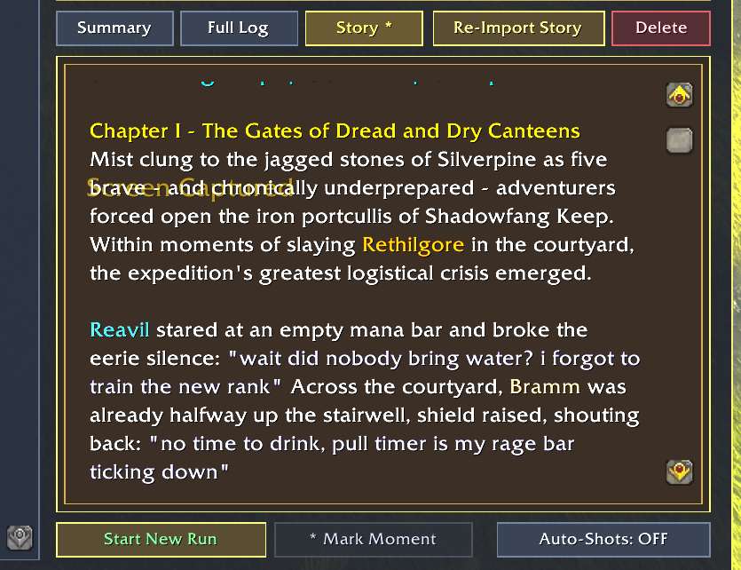

<p align="center"></p>

<h1 align="center">RP Chronicler</h1>

<p align="center"><b>Roleplay in World of Warcraft: Forever with your own character, without typing a novel. Then turn your runs into stories.</b></p>

RP Chronicler is a free addon that sits between WoW and the AI you already use (Gemini, ChatGPT or Claude). It never sends chat and never goes online. It copies text out, and you decide what to paste back.

**What it does:**

- **One-key RP replies.** Press `Ctrl+C` and RP Chronicler copies the scene: who spoke to you, your target, your party, your pet, your quest, recent chat and your notes on the people there. Paste it into your AI with your character skill and get five short in-character lines, one per mood. Paste your favorite into chat.
- **Companions that remember.** Save players, NPCs and pets with their relationship, tone and one note on who they are and what you went through together. Your notes go into every copy where that person is in the scene.
- **Runs become stories.** Dungeons and raids record by themselves, and open-world adventures record when you start them. RP Chronicler packs fights, bosses, quests, places, levels, loot and party banter into one Full Log. Your AI turns it into a colored story that you read in the in-game **Story Book**.
- **Stories with your screenshots.** Your screenshots join the run with captions. `StoryViewer.html`, in the addon folder, shows every story in your browser with the pictures placed in the story, and saves it as one web page you can keep or share.
- **Use what you want.** RP Copy and the recordings are separate: the setup on first login asks whether you want RP Copy, recordings and stories, or both. Turn RP Copy off and none of it runs.
- **Private by design.** Everything stays on your PC, and `/rp wipe` deletes it all.

<p align="center"><br><i>The in-game Story Book</i></p>

<p align="center"><br><i>A story as a web page, screenshots in place</i></p>

**How an RP reply works:**

1. **In WoW**, someone talks to you. Press `Ctrl+C` and RP Chronicler copies the scene.
2. **In your own AI** (Gemini, ChatGPT or Claude, with your character skill), paste it. Its first line, `[Skill Call] use <trigger>`, calls your skill.
3. **Your AI answers** with five short in-character replies, one per mood. Pick the one you like there and copy it.
4. **Back in WoW**, paste it into chat (`/s`, `/p`, `/w` and so on) and send it yourself.

- **Version:** 0.6.2 beta (interface `16001`, WoW: Forever)
- **Saved variables:** `RPChroniclerDB` (account-wide, on your PC only)
- **License:** MIT

**Contents:** [Quick start](#quick-start) | [Requirements](#requirements) | [Character skill](#the-character-skill) | [Companions](#companions) | [Slice tabs](#slice-tabs) | [Adventures](#adventures-recording-runs) | [Story Book](#the-story-book) | [Screenshots and export](#screenshots-and-export) | [Privacy](#privacy) | [Commands](#slash-commands) | [Keybinds](#keybindings) | [Bugs](#reporting-bugs) | [Install](#installation) | [Developers](#for-developers)

---

## Why RP Chronicler

- **RP without the typing.** In a busy party or a fast whisper exchange you don't have time to write a good reply. One key gives your AI the whole scene.
- **Your character, consistently.** The skill holds your character's voice, moods, faction and running jokes, so every reply sounds like the same person.
- **Context the AI can't see.** Where you are, who you're talking to and what they said, combat, HP, your pet, your party, your quest, and your own notes on the people around you.
- **You stay in control.** RP Chronicler only copies text out. You choose what to say and paste it yourself.

---

## Quick start

1. **Install** the addon (see [Installation](#installation)) and log in. A short **setup** opens once: what you want to use (RP Copy, recordings and stories, or both), auto-recording of dungeons and raids, and screenshots. Click **Start**, and change any of it later in **Options**.
2. Type `/rp`. The rail on the left switches between **Copy**, **Companions**, **Adventures** and **Story Book** (Copy is hidden while RP Copy is off). The **gear** at the top right opens **Options**.
3. **Create your character skill** (one time): gear > **AI & Stories** > **RP Template**, copy it, paste it into your AI, fill in your character, and pick a short trigger such as `use <your name>`. Enter that trigger as the **Skill Call** in **Options > Slice Tabs**. See [The character skill](#the-character-skill).
4. **Play.** When someone talks to you, press `Ctrl+C` (or `/rp quick`). A toast confirms the copy. To steer the AI, use `/rp <instruction>`, for example `/rp make it flirty`.
5. **Paste into your AI.** It replies with 5 short options written for the channel. Copy one into WoW chat.

<details>
<summary><b>What a snapshot looks like</b></summary>

```
[Skill Call] use aloria
[Location] The Barrens - Crossroads
[Direct] [Whisper] Thrallgar: you look lost, need a hand with those raptors?
[Target] Thrallgar - Lvl 14 Orc Warrior [Friendly] [100%]
[Party] Aloria (Hunter) [DPS], Thrallgar (Warrior) [Tank]
[Status] Lvl 14 Hunter | 82% HP | [Out of Combat] | Pet: Snips (Crab, hunter pet) [Content]
[Known Player: Thrallgar]
Relationship: friendly rival, teasing
Who they are: loud orc warrior, owes me 5 silver. We cleared Wailing Caverns together and he pulled every patrol.
```

The `[Known Player]` block is added because Thrallgar is a saved companion with your notes (see [Companions](#companions)).

</details>

<details>
<summary><b>Example: from snapshot to replies</b></summary>

You press `Ctrl+C` in party chat and paste this into your AI:

```
[Skill Call] use aloria
[Location] Elwynn Forest - Northshire Valley
[Party] Thorgar: who just pulled the entire patrol
[Status] Lvl 6 Hunter | 64% HP | [In Combat] | Pet: Snips (Crab, hunter pet)
```

The skill answers with five options, one per mood, ready to paste into `/p`:

```
1. deadpan dramatic: destiny demanded a true test of our strength
2. petty & sharp:    my aim slipped, partly your fault for standing there
3. broke & wholesome: bright side, more pockets to loot if we live
4. pet-brained:      my pet made an executive decision
5. chaotic overkill: i'm vanishing in three seconds, good luck everyone
```

</details>

---

## Requirements

RP Chronicler is free and runs inside the game. You also need an AI chat that can keep a reusable set of instructions (a "skill"). Each of these has one on its free plan:

| AI | Where the skill lives |
|---|---|
| **Google Gemini** | A **Skill**: create a new Skill and paste the template as its instructions |
| **ChatGPT** | A **Project**: New project, paste the template into its instructions |
| **Claude** | A **Project** (paste the template into its instructions) or a **Skill** |

If your AI or plan has none of these, paste the template at the start of a new chat each time. It works, it's just more steps.

**Which model?** Fast, light models are fine for short RP replies. For stories, use the strongest model your AI offers (its "pro" or "thinking" model): it follows the color rules better and keeps the whole run in mind. If a story comes out short or forgets the start of the run, switch to a stronger model, or pick a shorter **Log detail** in **Options > Recording**. The **size meter** above each Full Log turns orange near, and red past, the warning size you set there (about 60,000 characters suits free plans).

**Building a skill (one time each):**

1. In RP Chronicler, open gear > **AI & Stories** and copy a template: **RP Template** for your character, **Dungeon/Raid Story** and **Adventure Story** for the storyteller.
2. In your AI, make a Skill (Gemini or Claude) or a Project (ChatGPT or Claude), and paste the template as its instructions. For the RP template, fill in your character first.
3. Open a chat with that skill and paste what RP Chronicler copied. The first line (`use <trigger>`, `use wow-dungeon-raid-story`, `use wow-open-world-story`) tells the AI which skill to use. The story lines are the skills' own names from the templates.

---

## The character skill

The RP template is a **starter**. Personalize it: replace every `<...>` field and make it yours, with your character's personality, backstory, voice, quirks, five moods and the way they talk. The more of your character is in it, the better the replies.

The template asks the AI for:

- **A voice that reacts to the room.** Replies engage with the actual joke, quest, monster or player in the log, and never recycle stock catchphrases.
- **Chat-sized lines.** Casual lowercase, one short sentence each. Pick **Short**, **Medium** or **Long** replies in **Options > AI & Stories** before you copy the template.
- **Five moods.** You name them (for example deadpan dramatic, petty, wholesome, pet-brained, chaotic overkill), and each option is labeled with its mood.
- **Channel rules.** General and Guild stay conversational, Party is teammate banter, Say may use an emote, Whisper is one-on-one. No `/s` or `/p` prefixes.
- **Your notes.** `[Known Player]` blocks shape how your character talks to someone, without quoting your notes. An `[Instruction]` line is your direction, never chat.

You can keep several characters. Give each one its own skill and trigger, and switch the Skill Call in Options or make a separate slice tab per character.

<details>
<summary><b>Show the RP skill template</b></summary>

```text
---
name: <character-name>-rp-<class>
description: Generate short, lively World of Warcraft: Forever roleplay responses for a <gender> <Faction> <Race> <Class> (<Character Full Name>) inspired by <Persona Inspiration>. Use when the user pastes an RP Chronicler snapshot or a WoW chat screenshot for <First Name>, mentions <trigger> or <surname> (such as "use <trigger>"), or asks for <Class> RP replies in General, Guild, Say, Party or Whisper chat.
---

STARTER TEMPLATE: personalize it. Replace every <...> field, and make it yours: personality, backstory, voice, quirks, the 5 moods and how your character talks. The more of your character is in here, the better the replies. Delete this paragraph when you are done.

WOW FOREVER RP: <FACTION> <RACE> <CLASS> (<CHARACTER FULL NAME>)

Generate 5 short, natural, in-character English chat replies for <Character Full Name>, a <three or four personality words> <Faction> <Race> <Class> in World of Warcraft: Forever, inspired by <Persona Inspiration>.

WHEN TO USE

- The user pastes an RP Chronicler snapshot that starts with "[Skill Call] use <trigger>" (with [Location], [Target], [Status], chat lines and maybe [Known Player] blocks), or uploads a WoW chat screenshot for <First Name>.
- The user includes triggers like "use <trigger>", "<trigger>" or "<surname>".
- The user asks for quick in-character <Class> responses in any WoW chat channel.

VOICE AND PERSONALITY

<First Name> feels alive because <she/he/they> actually reacts to what people are saying in chat instead of reciting catchphrases. <Describe the core of the voice in one or two sentences: the kind of humor, the attitude, what flips their mood.>

- React to the room first: engage directly with the specific joke, quest, monster or player in the log. Never force <Class> buzzwords into every line if they do not fit the conversation.
- Never repeat stock catchphrases: no canned openers like "i am <name>, the great...", and never reuse the same pet, spell or gear joke across turns. Invent fresh angles every time.
- Casual WoW chat rhythm: natural lowercase without stiff punctuation. Keep every option punchy: one short sentence or chat fragment (most about 5 to 14 words), never two sentences and never long comma-spliced speeches.
- Vary the length across the 5 options: some are a few words, one may run a little longer when the moment calls for it.
- [Known Player] blocks are the user's own notes on the people in the scene (relationship and who they are to <First Name>). Let them shape how <First Name> talks to that person, but never quote a note.
- If the snapshot has an [Instruction] line, it is the user's direction for these replies (tone, focus, who to answer). Follow it. It is not chat and never something a character said.

THE 5 RESPONSE ANGLES

Give 5 distinct options, one per mood, labeled with the mood:

1. <mood 1 name>: <one line on what this mood does, e.g. delivers an overly grand verdict on an ordinary situation, completely straight-faced>
2. <mood 2 name>: <e.g. quick snark, competitive pride, or a ridiculous excuse to save face>
3. <mood 3 name>: <e.g. counts every copper, eyes free food or loot, or shows a soft spot for allies>
4. <mood 4 name>: <a class or companion angle, e.g. blames the pet, a spell gone wrong, or questionable engineering>
5. <mood 5 name>: <e.g. casually escalates a minor problem into maximum collateral damage, then plans a quick exit>

CHANNEL AND FORMATTING RULES

- No channel prefixes: never start lines with /1, /g, /p, /s or /w. Output pure copy-paste-ready text.
- Match the channel:
  - [General] / [Guild]: zone or guild chatter. Keep it conversational and skip physical actions that distant players cannot see.
  - [Party]: teammate banter aware of pulls, mana breaks, loot and group survival.
  - [Say]: face to face. A standalone WoW emote (/shrug, /sigh, /giggle, /ponder) may go on its own line when it fits.
  - [Whisper]: a direct one-on-one reply tailored to the sender.
- Clean text: keep at least 4 options free of *action* asterisks (at most 1 brief *action*, only if it sharpens the joke). Always write in English.

EXAMPLES (replace them with lines in your character's own voice)

Input: [1. General] [Kaelen]: anyone seen the rare tiger spawn near the ridge?

1. <mood 1>: that beast and i have unfinished business, stay back
2. <mood 2>: even if i did, why would i hand over my own prey?
3. <mood 3>: if it drops decent leather, i'm helping you look
4. <mood 4>: you mean my future best friend? don't you dare
5. <mood 5>: just pull the whole ridge and i'll sort out the survivors

Input: [Party] [Thorgar]: who just pulled the entire patrol

1. <mood 1>: destiny demanded a true test of our strength
2. <mood 2>: my aim slipped, partly your fault for standing there
3. <mood 3>: bright side, more pockets to loot if we live
4. <mood 4>: my pet made an executive decision
5. <mood 5>: i'm vanishing in three seconds, good luck everyone
```

The reply-length line changes with the **Short / Medium / Long** setting in **Options > AI & Stories**. The RP template is part of RP Copy, so it is hidden while RP Copy is off.

</details>

---

## Companions

The more your AI knows about who you're talking to, the better the replies get. A companion can be a player, an NPC or a pet.

- **Add someone:** target them and click **Capture Target** in Companions, type `/rp capture`, use the **Capture Target** key you set in the game's Key Bindings, or right-click a player in game and pick **Add as RP Chronicler companion**.
- **Write your notes:** first and last name, **Relationship** and **Tone**, plus one note, **Who they are (note)**, for who they are and what you went through together (up to 2000 letters, with a counter). In 0.6.1 the old **Our history** note was added to the end of **Who they are**, so nothing was lost. Auto-updates never touch your notes.
- **Find them again:** search the list and sort by name, last seen or first met. Each companion shows their class, guild, when you last saw them, when you first met, the runs you shared, and their latest chat.
- **Include:** per companion, **Auto** adds them when they are your target, in your group, nearby (on screen or chatting in the last 5 minutes) or in the copied chat, **Always** adds them to every copy, and **Never** keeps them out.
- **Nearby companions:** a chip at the bottom of the Copy view shows the saved companions around you: targeted, in your group, on a nameplate or mouseover, or chatting in the last 5 minutes. Someone you just added counts as nearby at once. Click it to open the first one.
- **In your runs:** companions you chat with during a run are listed in its Full Log with your notes, so the storyteller knows who they are.

Options > **Companions** turns each of these on or off. A copy holds up to 3 companion blocks, with notes cut to 300 letters.

---

## Slice tabs

Each tab is a "slice": a preset of what goes into the snapshot.

<details>
<summary><b>The built-in slices and how the copy reads</b></summary>

| Tab | Best for |
|---|---|
| **Chat** | Conversations nearby: the message to you, your target, say, yell, emotes and whispers |
| **World** | General, Trade, LFG and other numbered channels (never the OOC channel) |
| **Party** | Your group: party and raid chat, say and emotes from members, the roster (raids included) and status |
| **Guild** | Guild chat and officer chat |
| **Quest** | Questing flavor: your active quest, your target and NPC dialogue |
| **Loot** | Reacting to drops: green and better items and your coin, summed |

Change what every tab copies, built-in ones included, in **Options > Slice Tabs**, and add **custom tabs** with their own Skill Call. `Ctrl+C` always copies the slice you used last.

- **One timeline.** All the chat a tab includes is merged into one list in the order it happened.
- **No repeats.** The message to you is marked `[Direct]` in the timeline instead of being copied twice, and a companion's "Latest Chat" leaves out lines the copy already shows.
- **Busy channels stay out of the way.** Trade, General and LFG have their own buffer, and guild chat another, so they never push nearby RP out.
- **Clean loot.** Green and better items and who won them are kept, gray items and roll messages are left out, and coin is summed into one line.
- **One-time instructions.** `/rp make it flirty` or `/rp reply to Thrall only` goes at the top as `[Instruction]`, so the AI follows it instead of treating it as chat.

</details>

---

## Adventures: recording runs

RP Chronicler also works as a quiet chronicler. A recording captures what a storyteller needs: who was there, where you went, what you fought, who nearly died, what dropped, the quests you did, and what everyone said. It packs that into one **Full Log** that's ready to paste into your AI.

1. **Play.** Dungeons and raids record by themselves. In the open world, click **Start Recording**, use the `[RP]` icon's right-click menu or a key you set in the game's Key Bindings. Joining a group asks whether to start recording.
2. **Copy the Full Log** in Adventures: **Select All**, then `Ctrl+C`. Its first line calls the storyteller skill by its name: `use wow-dungeon-raid-story` for dungeons and raids, `use wow-open-world-story` for the open world.
3. **Paste it into your AI** with the matching storyteller skill (gear > **AI & Stories**, or **Template** in Adventures): **Dungeon/Raid Story** has one chapter per boss, **Adventure Story** is introspective with chapters by place and event.
4. **Import Story** and paste the colored story. It opens in the [Story Book](#the-story-book), named after the title the AI gave it.

<details>
<summary><b>How recording works</b></summary>

- **One Start / Stop button**, green to start and red (**Stop & Save**) while a run records, with **Pause** and **Mark Moment** next to it. Each also has a command and a Key Bindings entry.
- **The `[RP]` icon.** Left-click opens the window. Right-click opens a menu: Start or Stop, Pause or Resume, Mark Moment, **Open current recording**, Story Book, Clear chat logs. It turns red with a pulsing dot while recording, amber while paused.
- **Never lost.** After a `/reload` or a short disconnect the run continues. After a logout or a longer disconnect it is saved as **interrupted**, and the next login asks whether to **resume** or **keep** it.
- **Rich but short.** One meaningful line instead of many raw ones, and never out-of-character chat: `(( ))`, `[OOC]`, the OOC channel, guild and world channels stay out.
- **A Summary by run type.** Zeros are hidden, bosses and wipes show only for dungeons and raids, places only for the open world.
- **Roles always shown.** When nobody picked a role, RP Chronicler guesses Tank, Healer or DPS.
- **Fight context on chat**, for example `[Party | vs Boss 5% HP] Healer: OOM!!`.
- Up to 40 runs are kept.

</details>

<details>
<summary><b>The Full Log tags</b></summary>

Every line is timestamped `[HH:MM:SS]`. **Options > Recording** has a switch for each group of lines (fights and kills, bosses and danger, quests and NPCs, travel and progress, loot, group chat) and a **Log detail** of Short, Normal or Rich.

- `[FIGHTS]` a streak of plain trash fights folded into one line that updates as you go, for example `[FIGHTS] 6x Defias Thug (14:02-14:09) - all defeated - 1 fled briefly - used Multi-Shot, Serpent Sting`
- `[FIGHT]` one line for a notable fight, with the spells used, who took aggro, fleeing, and how it ended (defeated, it escaped, the party disengaged)
- `[KILL]` elites, rares and named foes. Trash is counted in the header as **Foes defeated**, broken down by type.
- `[PVP]` hostile players defeated, and PvP deaths
- `[BOSS ENGAGED]`, `[BOSS HP]` at 50%, 20% and 5%, `[BOSS RESET]`, `[BOSS KILL]`, `[BOSS CAST]`, `[WIPE #N]`
- `[AGGRO]`, `[DANGER]` under 10% HP, `[SAVED]`, `[LOW MANA]`, `[DEATH]` with what you were fighting, `[REZ]`
- `[SPELL]` only for big cooldowns and crowd control (other spells are folded into the fight line), `[CC]`, `[PET]` and `[PET DEATH]`. Pets are named with their species and kind, for example `Snips (Crab, hunter pet)`, or `Crab (hunter pet)` for a pet named after its species.
- `[QUEST]` quests accepted and completed, and `Objective done: <quest> - <objective>`. `[QUEST TEXT]` is the quest giver's words, trimmed.
- `[NPC]` and `[NPC Emote]` from bosses and named NPCs, throttled and de-duplicated
- `[LEVEL]`, `[PLACE]` new subzones (once they settle, no repeats)
- `[MILESTONE]` a new spell, a tamed or renamed pet (with its species), a new mount or companion pet, an achievement, a reputation
- `[LOOT]` quest items and green or better items with their source. Repeats of the same item become one line with `xN`.
- `[SHOT N]` a screenshot and its caption (see [Screenshots](#screenshots-and-export))
- `[HIGHLIGHT]` moments you marked

The header has the run type, zone, date and duration, levels gained, quests completed and places (open world), wipes (dungeons and raids), deaths, the roster with roles, guild and pets, Known companions with your notes, bosses, foes defeated, notable kills and loot.

</details>

---

## The Story Book

The Story Book has its own place on the rail. Every story your AI wrote is there under the title the AI gave it on its first line (`Title: Shadows Over Pyrewood`), with its dungeon or region, duration, date, party and the stats for that kind of run (bosses and wipes for dungeons, foes, quests, levels and places for the open world).

- **Read** it in game, with gold chapter titles, class-colored party names, crimson bosses and foes, sea-green pets and turquoise places. Bosses get an icon: a skull, a gold dragon for an elite, a silver dragon for a rare.
- **Auto-color.** Names the AI left plain are colored from the run itself: party (with surnames), pets and their species, places, foes, NPCs and quest givers, and items. A name the AI colored once is colored everywhere. It works on stories you already imported too.
- **Share** copies the story as clean plain text for Discord or a forum. **Details** renames the story or edits any other field. **Re-Import** replaces the text and keeps your details. **Run** jumps to the recording. **Delete** removes the story. **Copy for viewer** (in the tip above the story) hands a story you imported this session to `StoryViewer.html`. **+ Import** at the top of the list adds a new one.
- **Titles come from the AI.** Both story templates ask for `Title: <name>` on the first line, and RP Chronicler names the story from that line, never by guessing. A story without one keeps the run's name until you rename it.
- **Stories stand on their own.** Deleting a recording keeps its story and its details.
- Drag the grip in the bottom-right corner to make the reader bigger.


---

## Screenshots and export

- **Auto screenshots** on boss kills, level ups and marked moments, combat-safe and capped per run. **Options > Recording > Auto-screenshots** picks **Dungeons and raids** (the default; in the open world only Mark Moment takes one), **Everywhere** or **Off**.
- **Your own screenshots** taken with Print Screen during a run join it, with a caption such as "Fighting Hogger in Elwynn Forest".
- Each shot is listed in the Full Log as `[SHOT N]`, and the story templates ask the AI to put a `[Shot N]` marker where it fits. The in-game reader hides these markers.

**Read stories in your browser:** double-click `StoryViewer.html` in `Interface\AddOns\RPChronicler`. It is a plain web page that works offline and needs nothing installed.

1. The first time, click **Choose WoW folder** and pick your `_forever_` folder (for example `C:\Program Files (x86)\World of Warcraft\_forever_`). Chrome and Edge remember it, so later you only click **Refresh**.
2. Click a story to read it with its screenshots in place, and **Save story** to keep it as one web page with the pictures inside (it goes to your Downloads folder).

- **When stories appear:** the game saves your stories to disk when you log out or switch characters, so older stories are always there. For a story you imported this session, click **Copy for viewer** in the Story Book tip, press `Ctrl+C`, and paste it into **Paste a story** on the page.
- **If the folder is refused:** Chrome and Edge won't open folders under `Program Files`, and Firefox can't remember folders. Then use **Choose RPChronicler.lua** (in `_forever_\WTF\Account\<your account>\SavedVariables`) and, to save pictures with a story, **Choose Screenshots folder**. You can also drag the `_forever_` folder onto the page.
- **Screenshot format:** browsers show the game's default JPG screenshots. If your game saves TGA, the Story Book tip offers **Use JPG**.
- **Power users:** the GitHub release zip also has `Export_Stories.bat`, which writes every story, its plain text and its Full Log to `_forever_\RP Chronicler Stories\` in one go (Windows PowerShell).

The Story Book tip can be closed (bring it back in **Options > AI & Stories**).

---

## Privacy

- **Everything stays on your PC**, in your WoW SavedVariables. RP Chronicler has no internet access and sends nothing anywhere. No account, email or real-world personal data is collected.
- **Chat leaves your PC only when you paste it** into your own AI tool, and that tool's privacy terms apply then.
- **Use only what you want.** The first-run setup asks whether you want **RP Copy**, **recordings and stories**, or **both**. With RP Copy off (also **Options > General > RP Copy**), the Copy view, `Ctrl+C`, slice tabs, the chat it keeps for the copy, Nearby companions and the RP reply template don't run at all.
- **Your choice of what is kept.** **Options > Privacy** has a switch per kind of chat: say, yell and emotes; whispers; party and raid chat; guild and officer chat; world channels; NPC dialogue. Out-of-character chat is never kept in a recording.
- **What RP Chronicler records:** recent chat in memory for RP Copy (only while it is on, cleared on `/reload`), auto-recording of dungeons and raids, the open-world prompt, screenshots in runs (auto screenshots in dungeons and raids by default, and your own Print Screen shots), companion updates from chat, the companions you see nearby (in memory only), and a debug log of RP Chronicler's own errors (never chat). The setup covers RP Copy, auto-recording and screenshots; every one of them has a switch in Options.
- **StoryViewer.html runs only in your browser.** It works offline, can't connect to the internet (its security policy blocks it), and reads only the folder or files you choose. A folder you choose is remembered by your browser only.
- **Delete everything** with `/rp wipe` or **Options > Privacy > Delete All Data** (click twice). It removes every recording, story, companion and setting and reloads the UI. Deleting `RPChronicler.lua` in your SavedVariables folder does the same.
- `/rp setup` shows the setup again. A later version that adds a new choice shows only the new ones.

---

## Slash commands

| Command | What it does |
|---|---|
| `/rp` or `/rpchronicler` | Open the RP Chronicler window |
| `/rp <instruction>` | Open the window with a one-time instruction for the AI added to the snapshot |
| `/rp quick` | Quick-copy the last used slice |
| `/rp capture` | Save or update your target (player, NPC or pet), or mouseover, or last whisperer, as a companion |
| `/rp companions` / `/rp adventures` / `/rp book` | Open the window on that view |
| `/rp start` | Start recording an adventure |
| `/rp mark [note]` | Bookmark the latest moment, or your note, in the active run |
| `/rp pause` / `/rp resume` | Pause or resume recording |
| `/rp end` | End and save the active run (also `/rp stop`) |
| `/rp options` | Open Options (also `/rp config`) |
| `/rp setup` | Show the privacy note and setup choices again (also `/rp privacy`) |
| `/rp wipe` | Delete all RP Chronicler data, after a confirmation |
| `/rp debug` | Open the debug report to copy into a bug report (`/rp debug clear` empties it, `/rp debug verbose` adds extra detail until you log out) |
| `/rp diag` | Print what RP Chronicler can read about your target and your guessed role |
| `/rp clear` | Clear the session chat, combat, NPC and loot buffers |
| `/rp btn` | Show or hide the floating `[RP]` button |

The window: drag the title bar to move it and the bottom-right grip to resize it. Right-click the grip to reset size and place. `Esc` closes it.

## Keybindings

RP Chronicler sets one key itself: **`Ctrl+C`** copies the scene when no text box is focused (turn it off in **Options > General**). It is set only while RP Copy is on.

Every other action is in **Esc > Options > Keybindings > AddOns > RP Chronicler**, with no key until you pick one: Open / Close Window, Quick Copy, Capture Target, Mark Moment, Start, Pause / Resume and End Recording. In 0.6.1 RP Chronicler's own keybind page was removed, so keys you set there (including the old `Shift+C` for Capture Target) need to be set again in the game's Key Bindings.

<details>
<summary><b>How Ctrl+C copying works</b></summary>

WoW addons can't write to the clipboard. RP Chronicler puts the snapshot, selected, in a hidden box, and your own `Ctrl+C` copies it. Pick the style in **Options > General**:

- **Instant** (default). Hold Ctrl a moment and RP Chronicler gets the box ready, so `Ctrl+C` copies on the first press. Other Ctrl shortcuts still work. If you press `Ctrl+C` very fast, the first press gets the box ready and a second copies.
- **Copy box.** `Ctrl+C` shows the snapshot, already selected, in a small box. Press `Ctrl+C` there to copy it, and the box closes by itself. Use it if Instant doesn't copy on your PC. RP Chronicler also falls back to this box by itself when the hidden box can't take the text.

Instant works in combat too. If a copy doesn't land, `/rp debug` shows the last copy attempt.

</details>

---

## Reporting bugs

RP Chronicler keeps a small debug log (about 200 lines) of its own errors, blocked actions and run events. It never stores chat.

1. Type `/rp debug` (or gear > **Privacy** > **Debug Report**).
2. **Select All**, `Ctrl+C`, and paste it into a [GitHub issue](https://github.com/azaxyno/RPChronicler/issues) with what you were doing.
3. Chasing something odd? Type `/rp debug verbose`, reproduce it and copy the report again.

If the game shows a "blocked from an action" popup, `Logs\taint.log` in your game folder names the file and line. Attach it too.

---

## Installation

1. Download `RPChronicler-vX.Y.Z.zip` from the latest [Release](https://github.com/azaxyno/RPChronicler/releases) (or from CurseForge) and unzip it into your AddOns folder, so the folder is named exactly `RPChronicler`:
   ```
   World of Warcraft\_forever_\Interface\AddOns\RPChronicler\RPChronicler.toc
   ```
2. Restart the game, and enable **RP Chronicler** on the character select AddOns screen.
3. Log in. The setup opens once. Then type `/rp`.

---

## For developers

<details>
<summary><b>Architecture</b></summary>

All files share the addon's private namespace (`local ADDON_NAME, ns = ...`). WoW loads them in the order in `RPChronicler.toc`, and the order matters.

| # | File | Role |
|---|---|---|
| 1 | `Core.lua` | The settings list (`ns.SETTINGS` with `ns.Get` / `ns.Set`), migrations, default tabs, chat sources, Full Log groups and tags, log detail, capture types, privacy text and wipe, colors, roles, log buffers, `ns.Listen` / `ns.Notify` |
| 2 | `Game.lua` | Shared game reads (health, instance type, group units, spell names) and the one event router, `ns.On` |
| 3 | `Debug.lua` | Debug log, RP Chronicler-only error hook, blocked actions, the `/rp debug` report |
| 4 | `Companions.lua` | Companions: save, create, update, rename, delete, include, nearby, pet kind and species, `[Known Player]` blocks, the right-click menu entry |
| 5 | `Snapshot.lua` | Builds the snapshot from the active slice |
| 6 | `Runs.lua` | Run lifecycle, interrupted runs, every recorded line, timeline, screenshots |
| 7 | `RunReport.lua` | Summary, Known companions and the Full Log |
| 8 | `Stories.lua` | Story storage, Story Book details and titles, boss icons, auto-color |
| 9 | `Templates.lua` | The RP template and the two story templates |
| 10 | `Screenshots.lua` | Combat-safe auto screenshots and your own screenshots |
| 11 | `Events.lua` | Game events to recordings, chat buffers and capture switches, loot, combat poller, run trackers |
| 12 | `Chronicle.lua` | Fights and streaks, kills, PvP, quests and objectives, NPCs, levels, places, milestones, prompts |
| 13 | `UI_Shell.lua` | `ns.UI`, theme and widgets, main window, rail, resize |
| 14 | `UI_Copy.lua` | Copy view, quick-copy engine, Nearby companions chip |
| 15 | `UI_Companions.lua` | Companions view |
| 16 | `UI_Adventures.lua` | Adventures view, record bar, run list, size meter, story import |
| 17 | `UI_StoryBook.lua` | Story Book section: library, reader, Share, Details, Re-Import, Delete |
| 18 | `UI_Options.lua` | Options pages and the template window |
| 19 | `UI_Setup.lua` | First-run setup |
| 20 | `UI_Commands.lua` | The Ctrl+C binding, floating `[RP]` button and menu, `/rp` commands |
| | `Bindings.xml` | Key Bindings entries |
| | `StoryViewer.html` | Reads your stories and screenshots in the browser, offline, and saves a story as one web page |
| | `Export_Stories.bat` | Windows exporter (GitHub zip only): all stories, text and Full Logs at once |
| | `Media/logo.tga` | The logo shown in the setup |

</details>

<details>
<summary><b>Saved data (<code>RPChroniclerDB</code>)</b></summary>

| Key | Contents |
|---|---|
| `tabs` | Your slice tabs (label, trigger, section toggles) |
| `players[name]` | Companions: kind, names, relationship, tone, your note, include mode, level, race, class, guild, first met, last seen, last 5 chat lines |
| `adventures` | Up to 40 runs: type, zone, dates, party, places, levels, quests, kills and foe counts, PvP, bosses, loot, milestones, highlights, timeline, screenshots |
| `stories` | Imported stories, each with its own copy of the run's details and its Story Book fields (title included), so it survives deleting the recording |
| `activeRun` | The run being recorded right now, so it survives `/reload` and disconnects |
| `capture`, `logGroups` | What chat is kept, and which Full Log groups are on |
| `setupVersion`, `wipedAt` | Which setup you've seen, and when you last deleted everything |
| `rpCopy`, `quickCtrlC`, `copyMode`, `messages` | RP Copy on or off, Ctrl+C, copy style, chat messages per source |
| `autoRecord`, `promptOnGroup`, `autoShots`, `logDetail`, `logWarnChars` | Recording options |
| `knownPlayerBlocks`, `autoUpdateKnown`, `companionMenu`, `runCompanions` | Companion options |
| `rpReplyLength`, `exportTip` | Template reply length, the Story Book export tip |
| `debugLog` | The debug log (no chat) |
| `frameW`, `frameH`, `frameX`, `frameY`, `optionsPage` | Window size, place and the last Options page |

Every setting is listed once in `ns.SETTINGS` (`Core.lua`) with its default and range. Settings removed in 0.6.1 are cleared once, so their default behavior comes back.

Session buffers (`ns.logs`) live only in memory and are cleared on `/reload` or `/rp clear`.

</details>

<details>
<summary><b>WoW: Forever compatibility notes</b></summary>

- The addon targets the WoW: Forever client (`## Interface: 16001`). APIs that don't exist on every client are checked first, so a missing API turns a feature off instead of erroring.
- `IsInInstance()` is called directly and both return values are used (`ns.InstanceKind` in `Game.lua`).
- WoW fonts can't draw Unicode symbols, so in-game text is plain ASCII with `|cffRRGGBB...|r` colors. Pasted text turns `|` into `||`, and `ns.NormalizeStoryText` converts it back.
- Screenshots fade `UIParent` with `SetAlpha` instead of hiding it, which avoids `ADDON_ACTION_BLOCKED` in combat.
- `COMBAT_LOG_EVENT_UNFILTERED` is Blizzard-only on this client, so RP Chronicler never registers it. A light poller reads boss HP from `boss1-5`, `target`, `focus` and party targets, ends pulls when the group leaves combat, and tracks aggro. Spells, casts, crowd control and pets come from `UNIT_SPELLCAST_*`, `UNIT_AURA`, `UNIT_PET` and `UNIT_HEALTH`. Values the client hides as "secret" are skipped; `/rp diag` shows what is readable.
- **Versioning.** Every change bumps `## Version` in `RPChronicler.toc`: a patch bump for small fixes, a minor bump for big updates, below 1.0 while in beta. Each version is tagged and published as a GitHub Release with a zip.

</details>

---

## Credits

The recording and event-engine techniques are adapted from [StoryTracker](https://github.com/ninepointlabs/wow-storytracker-addon) by Nine Point Labs (MIT). See [CREDITS.md](CREDITS.md).

## License

MIT, see [LICENSE](LICENSE).
